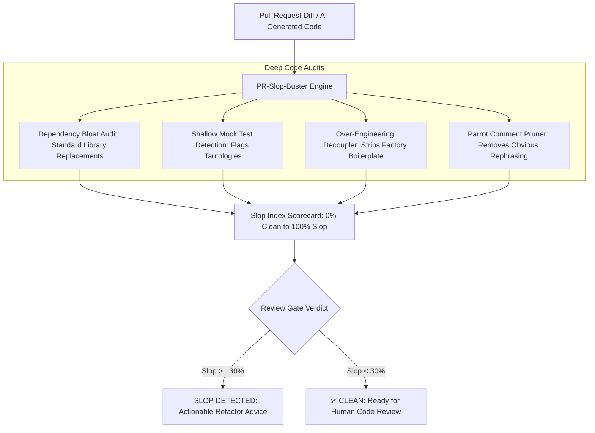

# 🧹 PR-Slop-Buster: AI Code Bloat & Dependency Auditor

<p align="left">
  
  
  
  
</p>

> An autonomous code review assistant for Cursor, Claude Code, and Copilot that strips AI-generated boilerplate, flags heavy dependency bloat, detects shallow tautological mock tests, and enforces minimalist clean architecture before human review.

---

## 📌 The Problem: The Rise of "AI Slop" in Pull Requests

With AI coding tools accelerating code generation, pull request volume has tripled. However, senior and staff engineers are burning out reviewing pull requests that look plausible on the surface but harbor hidden technical debt:

1. **Dependency Bloat:** AI assistants frequently import heavy 2MB external packages (`lodash`, `moment`, `request`) for trivial 3-line utility operations native to modern standard libraries.
2. **Fake / Tautological Mock Tests:** AI generates dozens of unit tests that mock out everything and assert nothing (e.g. `expect(true).toBe(true)`), giving teams a false sense of test coverage.
3. **Architectural Over-Engineering:** Prompts requesting simple features result in 300+ lines of redundant Abstract Factories, singletons, and complex wrapper classes where clean 20-line pure functions suffice.
4. **Review Fatigue:** Senior engineers spend hours wading through hundreds of lines of AI boilerplate trying to locate core business logic.

---

## 💡 The Solution: Autonomous Pre-Review Slop Gating

**PR-Slop-Buster** acts as a virtual Staff Architect reviewing code diffs before they reach human reviewers:


---

## 🛡️ The 4 Slop Audits Enforced

| Audit Category | What It Detects | Staff Architect Remediation |
| :--- | :--- | :--- |
| **Dependency Bloat** | Importing `lodash`, `moment`, or heavy utilities for basic array/date math. | Drop-in replacements using native modern standard library APIs. |
| **Shallow Mock Tests** | Tautological assertions (e.g. `expect(true).toBe(true)`, `assert True`). | Forces tests to verify concrete state mutations and boundary conditions. |
| **Over-Engineering** | Premature Abstract Factory or Singleton design patterns on small features. | Simplifies complex class hierarchies into pure, decoupled functions. |
| **Parrot Comments** | Comments that simply restate function names (e.g. `// get user`). | Prunes comment noise to let self-documenting code speak for itself. |

---

## 🛠️ Tech Stack

* **Engine:** Python 3.9+, Pydantic v2, Regular Expression Syntax Parsers
* **Interactive Dashboard:** Streamlit
* **Agent Integration:** Universal `SKILL.md` format for Cursor, Claude Code, and Copilot
* **License:** MIT License

---

## 🚀 Quickstart

### 1. Clone & Set Up
```bash
git clone [https://github.com/soniran635/pr-slop-buster.git](https://github.com/soniran635/pr-slop-buster.git)
cd pr-slop-buster

python3 -m venv venv
source venv/bin/activate

pip install -r requirements.txt
